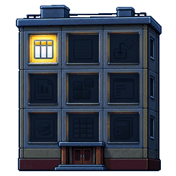
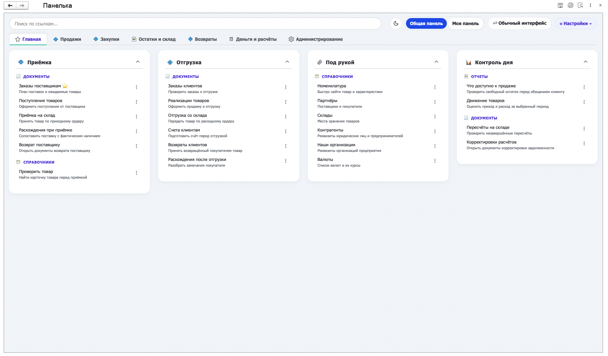

<h1 align="center">Панелька</h1>

  

<strong>НАСТРАИВАЕМАЯ ПАНЕЛЬ ДЛЯ 1С</strong>

  Соберите удобное рабочее место для себя и своей команды. 
  Документы, отчёты, обработки и ссылки в одном месте.

  
  
  

  <a href="https://github.com/n-bord/panelka-1c/releases"><strong>Скачать Панельку</strong></a> ·
  <a href="https://n-bord.github.io/panelka-1c/">Документация</a> ·
  <a href="#ut-demo">Пример в УТ 11</a>

## Зачем нужна Панелька

Когда «Избранное» разрастается, нужные отчёты и документы теряются в длинном списке. А новому коллеге приходится отдельно объяснять, что открыть для приёмки, как проверить остаток и где посмотреть заказы к отгрузке.

**Панелька позволяет собрать инструменты по рабочим задачам без доработки конфигурации.** Ссылки распределяются по страницам и колонкам; названия и подсказки объясняют, что откроется и для чего это нужно.

- **Общая панель** — раскладка для команды, которую настраивает администратор.
- **Моя панель** — личная подборка, если она разрешена в базе. Можно начать с пустой панели или взять за основу общую.
- **Два интерфейса** — обычная форма 1С и встроенный Web-режим с карточками, светлой и тёмной темами. Оба используют одну сохранённую раскладку.
- **Разные источники** — объекты конфигурации, открытые формы, избранное 1С, дополнительные отчёты и обработки, локальные EPF/ERF, веб-ссылки и стандартные инструменты.
- **Перенос настроек** — экспорт и импорт раскладки в XML.

## Быстрый старт

1. Скачайте `Панелька.epf` из [релизов проекта](https://github.com/n-bord/panelka-1c/releases). Перед первым запуском проверьте [совместимость и требования](https://n-bord.github.io/panelka-1c/docs/compatibility/).
2. Откройте файл через **«Файл → Открыть»** в тонком клиенте 1С. Для этого нужно право на интерактивное открытие внешних обработок. Для команды администратор может зарегистрировать Панельку через **«Дополнительные отчёты и обработки»**.
3. Откройте **«Настройки»** общей панели под администратором. Создайте колонки на **«Главной»** или добавьте страницы под отдельные задачи. Выберите названия и группы, удобные вашей команде.
4. В редакторе добавьте ссылки в нужную колонку: в обычном интерфейсе перетащите объект, в Web-интерфейсе выберите колонку и нажмите **«+»** у объекта. При необходимости измените название и подсказку; в Web-редакторе нажмите **«Применить»**.
5. Нажмите **«Сохранить и закрыть»** и проверьте открытие ссылок под будущим пользователем панели.

Если общая панель уже подготовлена, можно сразу [начать работать с ней](https://n-bord.github.io/panelka-1c/docs/interface/usage-example/). Для своей подборки см. [создание личной панели](https://n-bord.github.io/panelka-1c/docs/settings/personal-panel/).

Подробная [первая настройка](https://n-bord.github.io/panelka-1c/docs/getting-started/) описана отдельно для обоих интерфейсов. Краткая справка в обработке доступна по **F1**.

## Документация

**[Открыть документацию](https://n-bord.github.io/panelka-1c/)**

Пошаговые инструкции, снимки интерфейса и видео действий доступны на сайте. В статьях можно переключаться между вариантами **1С / Web**, чтобы видеть команды своего интерфейса.

| Что нужно сделать | Инструкция |
| --- | --- |
| Познакомиться с обработкой и выполнить первую настройку | [Введение](https://n-bord.github.io/panelka-1c/docs/introduction/) · [Быстрый старт](https://n-bord.github.io/panelka-1c/docs/getting-started/) |
| Разобраться в интерфейсе и повседневных командах | [Обзор интерфейса](https://n-bord.github.io/panelka-1c/docs/interface/overview/) · [Пример использования](https://n-bord.github.io/panelka-1c/docs/interface/usage-example/) |
| Настроить общую панель, отображение и порядок элементов | [Общие настройки](https://n-bord.github.io/panelka-1c/docs/settings/general/) |
| Создать группы ссылок, задать картинки, роли и подсказки | [Страницы, колонки и ссылки](https://n-bord.github.io/panelka-1c/docs/pages/create-page/) |
| Найти нужный объект или подключить внешний инструмент | [Объекты и источники](https://n-bord.github.io/panelka-1c/docs/pages/sources/) |
| Сохранить копию или перенести раскладку | [Импорт и экспорт](https://n-bord.github.io/panelka-1c/docs/settings/import-export/) |
| Создать и использовать свою панель | [Личная панель: пользователю](https://n-bord.github.io/panelka-1c/docs/settings/personal-panel/) |
| Разрешить личные панели и настроить ограничения | [Личные панели: администратору](https://n-bord.github.io/panelka-1c/docs/settings/personal-panel-admin/) |
| Проверить требования или разобраться с вопросом | [Совместимость и требования](https://n-bord.github.io/panelka-1c/docs/compatibility/) · [Частые вопросы](https://n-bord.github.io/panelka-1c/docs/faq/) |

## Пример настройки в УТ 11

Демонстрационная раскладка собрана в **УТ 11.5.22.77**: **7 страниц, 24 колонки и 50 уникальных ссылок**. Она показывает, как можно разделить приёмку, отгрузку, продажи и другие задачи, подобрать названия и добавить подсказки.

Это пример организации панели, а не готовое рабочее место для внедрения в УТ. Выбирайте состав ссылок и их расположение под задачи и права своей команды.

**[Посмотреть описание и видео двух интерфейсов](https://n-bord.github.io/panelka-1c/docs/ut-example/)** · **[Скачать XML раскладки](<Документация/Пример_УТ11/Пример Панельки в УТ 11.xml>)**

Перед загрузкой сохраните копию текущей настройки. XML переносит раскладку и общие параметры, но не документы базы и не права пользователей. Порядок загрузки и проверки описан в [инструкции по импорту](https://n-bord.github.io/panelka-1c/docs/settings/import-export/).

## Совместимость и доступ

Панелька предназначена для **тонкого клиента 1С** и управляемого приложения, рассчитана на конфигурации с **БСП** или совместимой реализацией используемых методов. Версия **v1** проверялась на Windows и macOS в следующих окружениях:

| Платформа | Конфигурация |
| --- | --- |
| 8.3.21.1393 | Самописная ERP |
| 8.3.27.1606 | Самописная WMS |
| 8.3.27.2342 | УТ 11.5.22.77 |

Web-интерфейс работает **внутри обработки в тонком клиенте**. Работа в браузерном веб-клиенте 1С отдельно не проверялась.

Ссылки открываются с правами текущего пользователя. Роли страниц и колонок управляют видимостью элементов панели и не предоставляют доступ к объектам конфигурации. Локальные EPF/ERF требуют доступного пути и соответствующих прав; запуск внешних файлов выполняется с отключённым безопасным режимом.

Подробности о режиме совместимости, необходимых методах БСП и проверке перед внедрением — в [требованиях к окружению](https://n-bord.github.io/panelka-1c/docs/compatibility/). Условия подключения внешних файлов — в статье [«Объекты и источники»](https://n-bord.github.io/panelka-1c/docs/pages/sources/).

Вопросы о доступе, сохранении изменений, личных панелях и переносе настройки разобраны в [частых вопросах](https://n-bord.github.io/panelka-1c/docs/faq/).

## Планы развития

- **Панелька как расширение.** Разместить панель на начальной странице 1С.
- **Доступ по профилям и группам.** Использовать принятые в базе группы доступа, сохранив настройку по ролям.
- **Несколько рабочих панелей.** Собирать отдельные наборы страниц для пользователей, администраторов, разработчиков и других команд.
- **Дополнительный режим отображения.** Добавить ещё один вариант компоновки той же панели.

---

Проект создан с помощью Codex с использованием плагина Unica для работы с 1С.

[Проект обработки для 1С:EDT](<Панелька Для ЕДТ>) · [Автор n-bord](https://github.com/n-bord)
